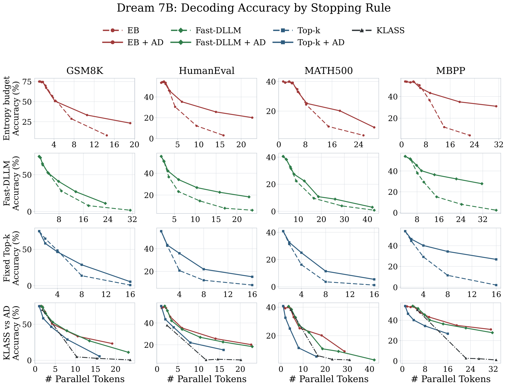
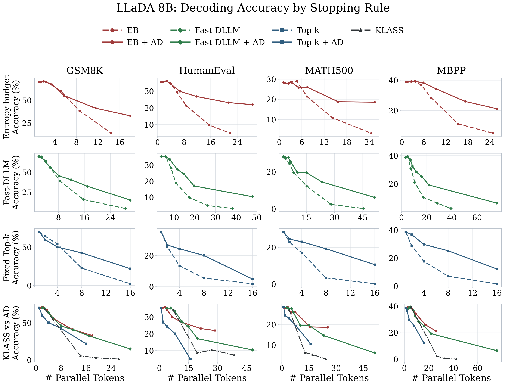

# Attention-Discounted Adaptive Sampler (ADAS)

[](https://arxiv.org/abs/2606.10829)
[](https://arxiv.org/pdf/2606.10829)
[](LICENSE)

Official implementation of **Attention-Discounted Adaptive Sampler for Masked Diffusion Language Models**.

ADAS is a training-free reranking rule for parallel masked diffusion decoding. It leaves the stopping rule of the base sampler unchanged and greedily discounts a candidate when it attends strongly to already selected positions whose predictions remain uncertain. The implementation supports Dream-7B-Base and LLaDA-8B-Base with fixed Top-k, Fast-dLLM, and EB-Sampler stopping rules.

Across GSM8K, MATH500, HumanEval, and MBPP, ADAS improves matched low-NFE performance by **9.11 percentage points for LLaDA-8B-Base** and **10.46 points for Dream-7B-Base** on average, with **3.1% per-forward runtime overhead**.

## Main results

Solid lines use ADAS reranking; dashed lines are the corresponding vanilla stopping rules. Click either figure for the vector PDF.

<a href="assets/dream_main_results.pdf"></a>

<a href="assets/llada_main_results.pdf"></a>

## Method

At each denoising step, let `M` be the currently masked positions and `S` the positions already selected for unmasking in the current step. ADAS greedily selects the next position using

```text
score(i | S) = c_i - alpha * sum_{s in S} A_{i,s} * (1 - c_s),   i in M \ S.
```

Here `c_i` is token confidence and `A_{i,s}` is attention from candidate position `i` to already selected position `s`. The paper configuration is:

```text
alpha = 40
attention_discount_mode = candidate_to_selected
attention_discount_score_rule = additive
attention_discount_selected_uncertainty = confidence_gap   # weight is 1 - c_s
attention_discount_aggregation = sequential
attention_capture_aggregation = last_layer_mean
```

ADAS changes only candidate ordering. The base stopping rule still determines how many positions are unmasked.

## Installation

The evaluations use Python 3.10, lm-eval-harness 0.4.8, and Transformers 4.57.1. A CUDA GPU with enough memory for a 7B/8B model is required.

```bash
python -m venv .venv
source .venv/bin/activate
pip install --upgrade pip
pip install -r requirements.txt
```

Model weights are downloaded from Hugging Face on first use:

- `Dream-org/Dream-v0-Base-7B`
- `GSAI-ML/LLaDA-8B-Base`

## Unmasking strategies

Use `sampler=attention_discounted` and set `sampler_variant` as follows:

| Stopping rule | Vanilla ranking | ADAS ranking |
|---|---|---|
| Fixed Top-k | `confidence_topk` | `attention_discounted` |
| EB-Sampler | `eb_entropy` | `attention_discount_ab_budget_eb_stop` |
| Fast-dLLM | `fast_dllm` | `ad_fast_dllm` |

Stopping-rule parameters:

```text
Top-k:      set steps = gen_length / k
EB:         set gamma to the entropy budget
Fast-dLLM:  set gamma to the Fast-dLLM f value
```

Paper sweeps:

```text
EB / EB+ADAS:                 gamma in {0.001, 0.01, 0.1, 0.3, 1, 3, 10, 20}
Fast-dLLM:                    gamma in {0.3, 1, 2, 3, 5, 8, 12}
Fast-dLLM+ADAS:               gamma in {0.3, 1, 2, 3, 5, 8, 12, 20}
Top-k / Top-k+ADAS:           k in {1, 2, 4, 8, 16}
```

## Example evaluation

Dream-7B-Base on GSM8K with EB+ADAS:

```bash
python eval_dream.py \
  --model dream_dist \
  --model_args "model_path=Dream-org/Dream-v0-Base-7B,max_length=2048,gen_length=256,block_length=256,steps=0,sampler=attention_discounted,sampler_variant=attention_discount_ab_budget_eb_stop,gamma=3,attention_discount_alpha=40,attention_discount_mode=candidate_to_selected,attention_discount_score_rule=additive,attention_discount_selected_uncertainty=confidence_gap,attention_discount_aggregation=sequential,attention_capture_aggregation=last_layer_mean,attention_discount_base_alg=maskgit_plus,temperature=0.0,top_p=1.0,pad_to_max_seq_len=true" \
  --tasks gsm8k \
  --num_fewshot 8 \
  --include_path lm_eval_tasks \
  --batch_size auto \
  --output_path results/dream-gsm8k-eb-adas
```

For multi-GPU evaluation, replace `python` with, for example, `accelerate launch --multi_gpu --num_processes 4`.

To switch methods, change only `sampler_variant`, `gamma`, and—for fixed Top-k—the `steps` value. With `gen_length=256`, Top-k+ADAS at `k=8` uses `sampler_variant=attention_discounted,steps=32`; vanilla Top-k uses `sampler_variant=confidence_topk,steps=32`.

## Paper evaluation settings

| Benchmark | Task name | Few-shot | Generation length |
|---|---|---:|---:|
| GSM8K | `gsm8k` | 8 | 256 |
| HumanEval (Dream) | `humaneval_dream_paper` | 0 | 512 |
| HumanEval (LLaDA) | `humaneval_llada_paper` | 0 | 512 |
| MBPP | `mbpp` | 3 | 512 |
| MATH500 | `math500` | 4 | 512 |

All reported evaluations use temperature zero and the lm-eval-harness default few-shot seed, 1234. Dream HumanEval additionally uses:

```text
add_bos_token=true
prompt_add_special_tokens=true
escape_until=true
temperature=0.0
top_p=1.0
```

The shared ADAS selection logic is in [`attention_guided_sampling.py`](attention_guided_sampling.py). The model-specific lm-eval entry points are [`eval_dream.py`](eval_dream.py) and [`eval_llada.py`](eval_llada.py); paper-aligned task definitions are under [`lm_eval_tasks/`](lm_eval_tasks/).

## Citation

```bibtex
@misc{sahin2026attentiondiscounted,
  title         = {Attention-Discounted Adaptive Sampler for Masked Diffusion Language Models},
  author        = {Sahin, Yusuf and Saikia, Ahmed Rockey and Cevher, Volkan and Favaro, Paolo},
  year          = {2026},
  eprint        = {2606.10829},
  archivePrefix = {arXiv},
  primaryClass  = {cs.CL},
  url           = {https://arxiv.org/abs/2606.10829}
}
```

## Acknowledgments

This repository builds on the official [LLaDA](https://github.com/ML-GSAI/LLaDA), [Dream](https://github.com/DreamLM/Dream), and [lm-evaluation-harness](https://github.com/EleutherAI/lm-evaluation-harness) implementations. See [`LICENSE`](LICENSE) for licensing information.
